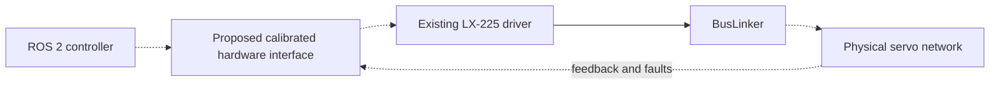

# Proposed LX-225 hardware integration

[Overview](system-overview.md) · [Actuation source](https://github.com/Pedronsjaja/gaia-lx225-buslinker/blob/main/docs/gaia_lx225.md)

**PLANNED — no `gaia_hardware_interface` package is implemented here.** The current backend is `gz_ros2_control/GazeboSimSystem`. A physical backend must meet the same joint semantics while handling serial timing, calibration and failures that ideal simulation omits.

The existing Python [driver](https://github.com/Pedronsjaja/gaia-lx225-buslinker/blob/main/servo_testbench.py) provides position, voltage and temperature queries and motion commands. Its velocity is derived from successive positions/times, not a measured velocity channel. Host timestamps are assigned after a position reply; queries are sequential, not simultaneous sensor acquisition. Current and torque are not measured by this software.

## Contract before code

| Requirement | Proposed contract / acceptance evidence |
| --- | --- |
| Ownership | One process owns a serial port; prevent CLI and ROS writers from competing. Test exclusive access and clean release. |
| Identity | Explicit joint name ↔ servo ID mapping tied to assembly/calibration revision. IDs are addresses, never angle units. Reject duplicate IDs and unknown joints. |
| Commands | Finite joint position in rad, bounded by validated joint limits. Reject missing calibration, invalid units and unsafe ranges before serialization. |
| Conversion | Define zero, sign and transmission ratio per joint. A possible convention is `servo_deg = zero_deg + sign * ratio * joint_rad * 180/pi`; this is a contract example, not established GAIA calibration. Verify inverse/round-trip and measured direction. |
| States | Joint position rad, validity and acquisition/receipt time; voltage V and temperature °C as diagnostics. Derived velocity rad/s must be labeled ESTIMATED and carry its method/age. Never report unsupported effort as measured zero. |
| Timing | Measure per-query round-trip, bus utilization, missed replies and jitter before selecting update rate/deadlines. Do not copy the simulator's 100 Hz. |
| Freshness | Separate valid current state, stale last observation and missing data. A transport timeout must not silently replay an old position as fresh. |
| Lifecycle | Initialization validates configuration; configuration establishes read-only communication; activation requires calibration and reviewed safe conditions; deactivation/error follows an explicit risk-assessed policy. |
| Fault handling | Test malformed replies, wrong IDs, checksum errors, disconnection, stale command, restart and unexpected motion. Define fail-safe response for each state. |
| Safety boundary | Communication-dependent stop is not independent emergency isolation. Holding, unloading and cutting power can have different fall/collapse risks. Validate the physical stop/support strategy before bench motion. |
| Logging | Preserve raw replies/commands, monotonic receipt time, experiment ID, units, calibration version and REAL/ESTIMATED provenance. Clock alignment uncertainty belongs in comparisons. |

The mechanical source supplies joint axes, zero, sign and limits; the actuator source supplies driver behavior and bench evidence. Unknown mapping, rates and physical thresholds remain UNKNOWN/NOT_MEASURED until approved measurements exist.

## Architecture options and decision gate

1. A read-only Python ROS node can expose existing bench feedback for experiments. This is not a ros2_control hardware plugin and must not be advertised as one.
2. A future ros2_control SystemInterface can manage a shared servo bus. The implementation language/transport boundary needs a separate design decision: native driver versus a bounded bridge to existing Python code. Avoid blocking serial work in an unbounded control loop.

The [Jazzy hardware-component guide](https://control.ros.org/jazzy/doc/ros2_control/hardware_interface/doc/writing_new_hardware_component.html) documents the plugin/lifecycle model. Verify installed headers when implementing; this document intentionally does not supply a pretend compilable interface.

## Test sequence

Unit-test conversions, parser failures and mapping first; inject delayed/missing replies with mocked transport. Next collect read-only one-servo evidence, then bounded one-joint motion with an approved fixture and stop strategy. Add ROS/controller integration only after timing/fault behavior is characterized. Expand to multi-joint bench and supported limbs before the whole robot. [Test strategy](../test-strategy.md) and [roadmap](../roadmap/simulation-to-real.md) define the separate gates.
