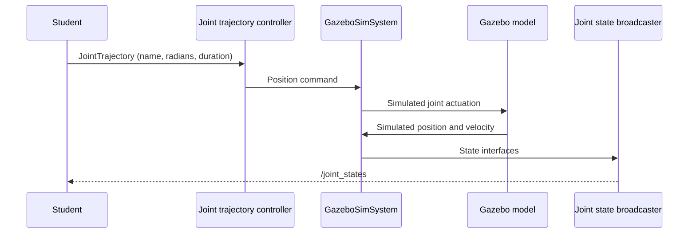

# ROS 2 and simulation runtime

[System overview](system-overview.md) · [Lab](../simulacao/instalacao-e-laboratorio.md)

A node is a runtime participant; a package is a distributable unit. A launch file starts processes and connects configuration. Topics stream observations/commands, services perform request/response operations, and actions track longer goals with feedback/cancellation. This lab uses a trajectory topic; an action client is not implemented by the tutorial.

## Trace the implementation

| File | Responsibility | Boundary |
| --- | --- | --- |
| [op3.repos](../../simulation/op3.repos) | Pin upstream model revision | Not GAIA geometry |
| [model.py](../../ros2/gaia_op3_sim/gaia_op3_sim/model.py) | Check 20 expected joints, preserve upstream elements, add fixed support, ideal sensors and simulated hardware | No serial access or servo dynamics |
| [lab.launch.py](../../ros2/gaia_op3_sim/launch/lab.launch.py) | Expand Xacro, start Gazebo, robot_state_publisher, model spawn, bridge and controller spawners | `gui` and `fixed_base` default true |
| [controllers.yaml](../../ros2/gaia_op3_sim/config/controllers.yaml) | Position commands, position/velocity state, partial joint goals | 100 Hz is configured simulation update rate, not measured physical capacity |
| [bridge.yaml](../../ros2/gaia_op3_sim/config/bridge.yaml) | Gazebo → ROS clock, IMU, image, CameraInfo | Does not bridge physical devices |
| [lab.sdf](../../ros2/gaia_op3_sim/worlds/lab.sdf) | World, physics and sensor systems, teaching target | Not a validated GAIA environment |

## Interface inventory

All observations below are SIMULATED. These are configuration values, not measured host throughput or real sensor specifications.

| ROS interface | Type / role | Time, units, frame and limits |
| --- | --- | --- |
| `/joint_trajectory_controller/joint_trajectory` | `trajectory_msgs/msg/JointTrajectory`; topic commands | Joint positions in rad; `time_from_start` in s; OP3 joint limits only |
| `/joint_states` | `sensor_msgs/msg/JointState`; broadcaster | rad and rad/s; match values by joint name; publication throughput must be measured |
| `/controller_manager/list_controllers` | `controller_manager_msgs/srv/ListControllers`; service | Smoke uses it to require active controller |
| `/clock` | `rosgraph_msgs/msg/Clock`; GZ_TO_ROS | Virtual time; can pause/reset independently of host time |
| `/gaia/imu` | `sensor_msgs/msg/Imu`; GZ_TO_ROS | `body_link`; configured 50 Hz; ideal model, not physical calibration |
| `/gaia/camera/image_raw` | `sensor_msgs/msg/Image`; GZ_TO_ROS | `gaia_camera_optical_frame`; 320×240 RGB, configured 15 Hz |
| `/gaia/camera/camera_info` | `sensor_msgs/msg/CameraInfo`; GZ_TO_ROS | Virtual camera calibration; not physical intrinsics |
| `/robot_description`, TF | Model and transforms from robot_state_publisher | Joint geometry is not global localization for a free base |

The standard trajectory controller also exposes a FollowJointTrajectory action; inspect the installed runtime with `ros2 action list -t` before using it. Future hardware must not assume that topic publication confirms goal success. See the [official controller interface](https://control.ros.org/jazzy/doc/ros2_controllers/joint_trajectory_controller/doc/userdoc.html).

## Clock, QoS and sensor interpretation

Nodes following the world use `use_sim_time=true`. Host monotonic time is used by the smoke test to detect interrupted or stale message delivery. The test does not compare successive `/clock` values or sensor timestamps: repeated messages can pass delivery checks without advancing virtual time. Check clock progression manually in the lab. Host time is not a shared clock with a real servo. Sensor QoS must match publishers; the lab uses best-effort subscriptions for sensor observations. A received image does not validate vision quality, and an IMU topic does not provide a state estimator.

The camera mount/optical frame and rates in `model.py` are teaching choices. Preserve their SIMULATED provenance. The [smoke test](../../ros2/gaia_op3_sim/test/smoke_sim.py) checks topic freshness, frames and head response, not balance/contact realism. Run [the test strategy](../test-strategy.md) before changing the pinned model or interfaces.
