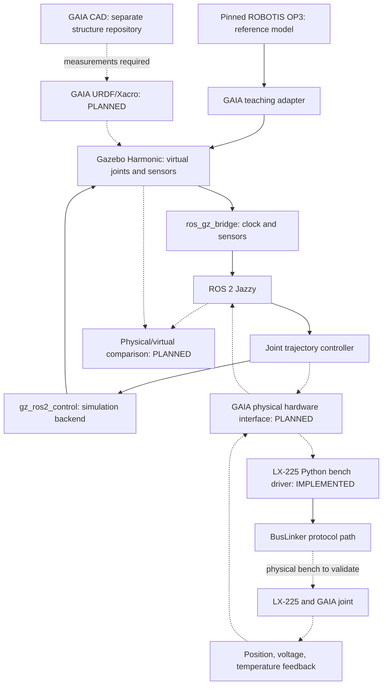

# The complete GAIA system

[Home](../../README.md) · [Status](../engineering-status.md) · [Learning path](../learning-path.md)

Think of a robot as a loop: a goal becomes a joint command; the mechanism moves; measurements tell the software what actually happened. A CAD file describes shape, a controller asks for motion, and a sensor reports an observation. None replaces the other.

## Layers and responsibilities

| Layer | Why it exists / GAIA responsibility | Current state |
| --- | --- | --- |
| Mechanical | Links carry loads; joints constrain motion; brackets locate axes. Structure repo owns CAD and measurements. | Assets exist; final assembly/model data UNKNOWN |
| Actuation | LX-225 converts commands into physical motion; BusLinker connects the serial bus. | Python bench driver IMPLEMENTED; physical performance NOT_MEASURED here |
| Hardware abstraction | Translate calibrated joint names/radians into servo addressing and units, then return state and faults. | PLANNED; [contract](hardware-integration.md) |
| ROS 2 | Nodes communicate through typed topics, services and actions; packages organize software. | Simulation launch and sensor interfaces IMPLEMENTED |
| Control | Joint trajectory controller interpolates requested joint positions. It does not choose footsteps. | IMPLEMENTED in OP3 simulation |
| Simulation | Gazebo evolves the virtual world, contacts and sensors. | OP3 fixed-base lab IMPLEMENTED / EXPERIMENTAL |
| Sensors | Camera, IMU and joint states describe observations with time and frame. | Virtual sensors IMPLEMENTED; installed physical sensors UNKNOWN |
| Perception | Turn images into task observations and quantify latency/error. | PLANNED; no OpenCV/YOLO detector selected or implemented here |
| Autonomy | Estimate state, select tasks, plan motion, balance and walk; localization only when a task needs it. | PLANNED; not supplied by installing ROS |
| Digital Twin | Compare a calibrated physical system with its virtual counterpart over aligned time. | PLANNED; no synchronized GAIA twin |

## Main system diagram

Solid arrows show the existing simulation path or bench software path. Dashed arrows are planned integration, not a working whole-system connection. Existing bench code does not prove connected hardware today.

The joint-state broadcaster is part of ros2_control, not the Gazebo sensor bridge. The controller manager is instantiated by the Gazebo plugin. See the [runtime map](ros2-architecture.md) for exact files and message paths.

## OP3, Vinicius and GAIA have different roles

- Vinicius humanoid: external functional/architectural comparison; access-controlled material and licensing constraints apply. No imported assets or parameters.
- ROBOTIS OP3: pinned simulation/ROS learning platform, with upstream attribution intact.
- GAIA structure: source of the intended real geometry, axes, dimensions, masses and mechanical limits.
- Hiwonder LX-225: intended GAIA physical actuator, with its own bench characterization.
- GAIA simulation model: future model generated from GAIA data, not an OP3 model with renamed links.

## Experiment: follow one command

Read `model.py`, `controllers.yaml` and `bridge.yaml` in [the ROS package](../../ros2/gaia_op3_sim). Follow [the first lab](../simulacao/instalacao-e-laboratorio.md) and command only `head_pan` in the isolated simulator. Match its name index in `/joint_states` to its position in radians. Then locate the sensor topics in the bridge YAML.

Validation: explain why `/joint_states` and `/gaia/imu` take different routes, and why success says nothing about LX-225 torque or GAIA balance. Next: [from simulation to real](../roadmap/simulation-to-real.md).
