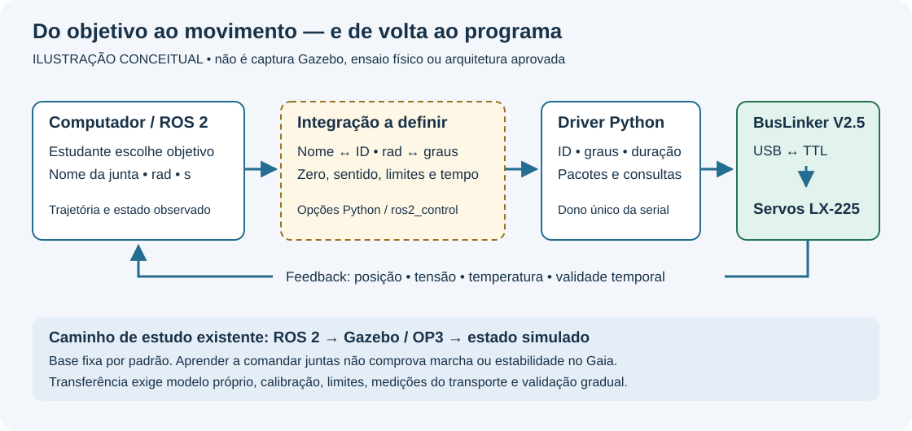
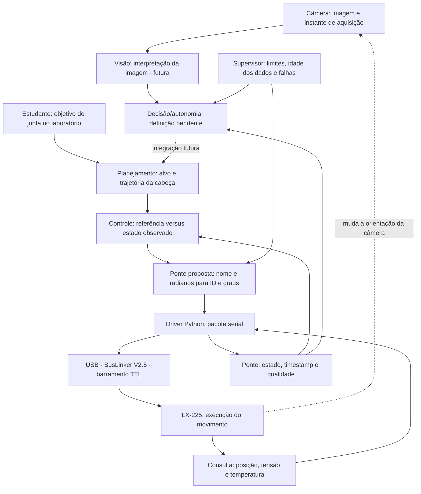
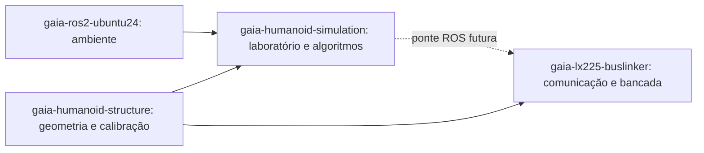
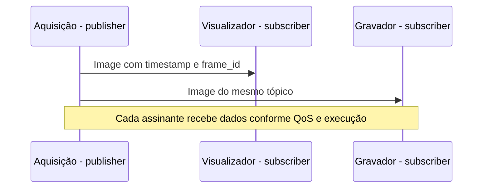
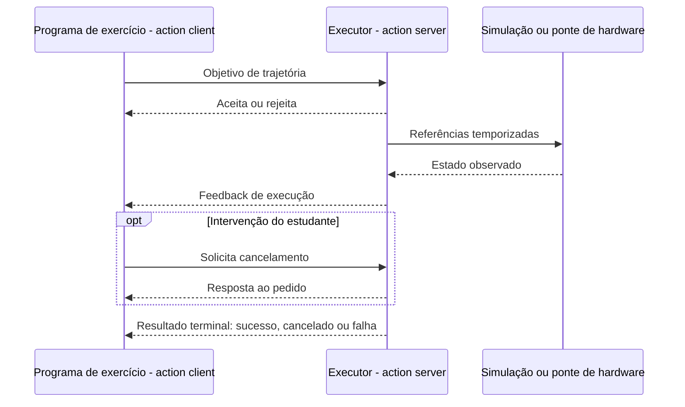
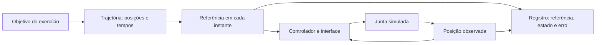

# Da câmera aos servos: Python e ROS 2 no Gaia

[Programação](README.md) · [Laboratório OP3](../simulacao/instalacao-e-laboratorio.md) · [Referências e evidências](referencias-camera-servos.md)

Este guia explica como dados de câmera, programas Python, interfaces ROS 2 e comandos de servos se relacionam. O exemplo de movimento é um objetivo de junta escolhido pelo estudante no laboratório. **A tomada de decisão/autonomia fica pendente**, sem algoritmo, máquina de estados ou estratégia de futebol definida aqui.

O público é quem está aprendendo Python e ROS 2 Jazzy. Leia primeiro as seções 1–4, desenhe o caminho de uma mensagem e depois estude trajetórias, feedback e conversão de juntas. Não há programa de movimentação física para copiar deste guia.

## 1. O que já existe e o que estamos propondo

Diagnóstico por leitura do código e dos documentos em **24/10/2026**; revisões registradas nas referências. Nenhuma execução ROS, simulação ou movimentação física foi realizada para escrever este guia.

| Parte | Situação observada | Limite |
| --- | --- | --- |
| `gaia_op3_sim` | Pacote com launch, modelo adaptado, sensores virtuais e controladores | OP3 com base fixa por padrão; não é o Gaia físico |
| Python LX-225 | Driver serial, CLI, consultas e ensaios de bancada | Não detecta bola, não calcula cinemática nem equilíbrio |
| CAD e cadastro Gaia | Documentação dos dados necessários | Nomes finais, sensores instalados, zeros e limites: confirmar com a equipe |
| Percepção e decisão/autonomia | Camadas futuras, apenas localizadas no fluxo | Algoritmos e interfaces específicos permanecem pendentes |
| ROS 2 → BusLinker | Arquitetura ainda a definir | Ponte Python e componente `ros2_control` são opções a avaliar; não há escolha tomada neste guia |

**Evidência:** [SIMULADO] identifica a origem de dados virtuais; [MEDIDO] exige ensaio identificado; [DATASHEET] é especificação do fabricante; [CALCULADO] resulta de uma equação; [ESTIMADO] depende de um estimador; [ASSUMIDO] identifica hipótese didática; [NÃO VERIFICADO] identifica pendência. Código inspecionado não equivale a TESTADO EM HARDWARE. Use `NOT_MEASURED` para taxas reais ainda não medidas e `UNKNOWN` para cadastro desconhecido.

## 2. A viagem completa da informação



**Ilustração conceitual, não captura de execução.** O ambiente desta edição é Windows; `wsl --list --verbose` informou WSL não instalado, e `ros2`/`gz` não foram encontrados no PATH. Por isso não foi produzido GIF/vídeo real do Gazebo. Uma gravação futura deve mostrar revisão do modelo, base fixa, comando e feedback, seguindo o laboratório em Ubuntu. Não é necessário reiniciar ou instalar outra stack para ler esta aula.



As setas representam contratos entre responsabilidades. Não precisam corresponder a um computador por bloco. A câmera real e sua montagem são `UNKNOWN`; no laboratório existem sensores virtuais. A BusLinker transporta a comunicação entre o computador e o barramento: não decide onde está a bola. Cada servo é endereçado por ID; nome de junta e ID não são a mesma coisa.

Há dois retornos diferentes: a posição lida informa o que o atuador reporta; uma nova imagem mostra a cena após o movimento. Um comando aceito não prova que o movimento terminou, e uma posição reportada não prova ausência de folga ou colisão na estrutura.

### Onde procurar cada parte



| Repositório | Entrega que permite integrar |
| --- | --- |
| [Ambiente](https://github.com/Pedronsjaja/gaia-ros2-ubuntu24) | Ubuntu/ROS e teste de comunicação em cada PC |
| [Simulação](../../README.md) | Laboratório, contratos de software e avaliação de algoritmos |
| [Estrutura](https://github.com/Pedronsjaja/gaia-humanoid-structure/blob/main/docs/modelo-gaia.md) | Eixos, geometria, massas, inércias, zeros, sentidos e limites |
| [Driver](https://github.com/Pedronsjaja/gaia-lx225-buslinker/blob/main/docs/gaia_lx225.md) | Transporte, consultas e ensaios dos atuadores |

## 3. Python, pacote, nó e processo

Python é a linguagem em que escrevemos funções, classes e regras. Uma função pode converter unidades; uma classe pode manter o estado de uma conexão; uma exceção pode sinalizar uma leitura que falhou. `rclpy` é a biblioteca cliente ROS 2 para Python. Instalar ROS não transforma automaticamente qualquer script em nó.

| Termo | Significado no trabalho da equipe |
| --- | --- |
| Workspace | Diretório de trabalho ROS, geralmente com fontes em `src` e resultados de compilação/instalação em `build`, `install` e `log` |
| Pacote / package | Unidade organizada com metadados, dependências e recursos; `gaia_op3_sim` é um pacote existente |
| Executável | Programa que pode ser iniciado, por exemplo por `ros2 run` ou launch |
| Processo | Instância de programa em execução no sistema operacional |
| Nó / node | Participante do grafo ROS com uma responsabilidade lógica; um processo pode hospedar vários nós |
| Launch | Descrição de como iniciar programas, passar parâmetros e conectar configurações; não é o algoritmo de decisão |
| Parâmetro | Configuração de um nó, como timeout ou nome de uma porta; valores propostos precisam ser escolhidos e validados |

Exemplo de separação para estudar: um nó publica dados de câmera; um cliente envia objetivos escolhidos pelo estudante no simulador; uma futura interface de atuadores controla o acesso ao driver. Essa divisão ajuda a reproduzir falhas e trocar a câmera por uma gravação. Não é obrigatório criar um pacote por nó nem um nó por função. Comece com responsabilidades claras e amplie somente quando houver necessidade.

### “Agente” significa o quê?

Na arquitetura, podemos chamar de agente o software que observa e escolhe ações. A forma desse software no Gaia permanece pendente; este guia não escolhe uma implementação. **Agente não é uma primitiva universal do ROS 2 e não exige IA generativa, LLM ou aprendizado de máquina.** A palavra não identifica, por si só, um componente instalado. Não há necessidade de acrescentar IA para entender comunicação e controle.

## 4. Como os nós conversam

| Conceito | Exemplo nesta aula | Quem inicia e quem responde |
| --- | --- | --- |
| Mensagem | Imagem, estado de junta ou detecção com campos definidos | É o tipo de dado, não o programa |
| Tópico | Fluxo contínuo de imagens | Publisher publica; subscribers recebem |
| Publisher | Saída de imagens da aquisição | Produz mensagens de um tipo em um nome de tópico |
| Subscriber | Entrada de imagens da visão | Recebe mensagens e dispara uma callback |
| Service server | Consulta pontual de configuração, proposta | Recebe uma requisição e produz uma resposta |
| Service client | Ferramenta que pede essa configuração | Faz a requisição e aguarda a resposta |
| Action server | Executor de uma trajetória | Aceita ou rejeita objetivo, informa progresso e resultado |
| Action client | Planejador que solicita trajetória | Envia objetivo, recebe feedback e pode solicitar cancelamento |

**Client não é sinônimo de subscriber.** Um mesmo nó pode assinar estados de juntas, publicar diagnósticos e ser cliente de uma action. Serviço é adequado a uma operação curta de requisição/resposta; ação permite acompanhar uma tarefa prolongada. Fonte: [interfaces ROS](referencias-camera-servos.md#fontes-oficiais).





Cancelamento é uma solicitação processada pelo servidor; não é parada elétrica garantida. O executor precisa definir o comportamento físico durante a interrupção. Desligar torque indiscriminadamente pode derrubar um humanoide. A política física deve ser validada para a montagem.

### Callback, executor, QoS e relógio

Uma **callback** é uma função chamada quando chega uma mensagem, vence um timer ou ocorre outro evento. O **executor** organiza essas chamadas. Uma callback que fica esperando serial pode atrasar a análise de falhas no mesmo executor. A proposta deve usar operações limitadas por timeout e um único responsável pela serial; acrescentar threads não resolve automaticamente concorrência.

**QoS** define políticas de entrega e histórico. Publisher e subscriber precisam ser compatíveis. Na visão, acumular imagens antigas pode aumentar a latência mesmo quando nenhuma mensagem é perdida. Registre perda e idade dos dados; confiabilidade de transporte não significa atualidade.

Na simulação, os nós relevantes usam `use_sim_time` e `/clock`. Pausar Gazebo pausa esse relógio. Para vigiar travamento físico, um watchdog precisa de uma base de tempo que continue avançando. Nunca subtraia diretamente timestamp ROS de `time.monotonic()`: são domínios diferentes. Sincronização entre computadores e política para saltos de relógio precisam ser definidas.

## 5. Contratos: quem envia o quê?

Nomes propostos abaixo não são APIs já disponíveis. Frequência configurada não é frequência observada.

| Interface / situação | Origem → destino | Conteúdo, unidade e tempo |
| --- | --- | --- |
| `/gaia/camera/image_raw`, existente na configuração da simulação | Gazebo → bridge ROS → consumidor | `sensor_msgs/msg/Image`; pixels, timestamp e referencial; taxa observada `NOT_MEASURED` nesta atividade |
| `/gaia/camera/camera_info`, existente na configuração | Gazebo → consumidor | `CameraInfo`; modelo de câmera; não substitui calibração da câmera física |
| `/gaia/imu`, existente na configuração | Gazebo → consumidor | `Imu`; rad/s, m/s² e orientação conforme campos disponíveis; dados [SIMULADO] |
| Percepção → decisão, futura | Camadas ainda a definir | Tipos, nomes, conteúdo e taxas pendentes; sem algoritmo definido neste guia |
| `/joint_trajectory_controller/follow_joint_trajectory`, interface do controlador configurado | Cliente de planejamento → controlador no simulador | `control_msgs/action/FollowJointTrajectory`; juntas, posições em rad, tempos em s; verificar servidor ativo ao executar |
| `/joint_states`, esperado do broadcaster configurado | Simulação ou futura ponte → consumidores | `JointState`; nomes, posição em rad, velocidade em rad/s quando disponível; não inventar esforço |
| Chamadas `LX225Bus`, existentes em Python | Futuro dono da serial → driver | ID, graus e duração em s; transporte configurado a 115200 baud, não 115200 mensagens/s |
| Consultas LX-225, existentes | Driver ↔ servo por BusLinker | Posição em graus, tensão em V e temperatura em °C; velocidade estimada em graus/s |
| Diagnóstico da ponte, proposto | Ponte → supervisor/registro | ID, idade, validade, timeout e causa de falha; formato e taxa a definir |

O [controlador local](../../ros2/gaia_op3_sim/config/controllers.yaml) configura `update_rate: 100` e aceita objetivos parciais de juntas. Isso é configuração do laboratório, **não evidência de 100 Hz no barramento real**. O [bridge](../../ros2/gaia_op3_sim/config/bridge.yaml) expõe os sensores listados. Confirme os nomes no grafo após iniciar o laboratório.

## 6. Do objetivo escolhido pelo estudante à trajetória

No laboratório, o estudante escolhe uma junta e uma posição dentro dos limites do modelo. O programa cliente organiza um objetivo e o controlador tenta executar a trajetória usando o estado observado. A camada de decisão autônoma aparece no diagrama apenas para mostrar onde uma integração futura entraria; seu projeto fica fora desta aula.

Uma **posição alvo** descreve onde chegar. Uma **trajetória** acrescenta quando passar por posições intermediárias. Em uma junta de rotação, posição usa radianos; velocidade, quando fornecida, rad/s; aceleração, rad/s². Em `JointTrajectory`, `joint_names` estabelece a ordem dos valores de cada ponto, e `time_from_start` expressa o tempo relativo ao início. Os tempos dos pontos devem ser coerentes e crescentes. Não confunda tempo de trajetória com timestamp de aquisição do feedback.

Exemplo conceitual, sem números de hardware: o objetivo lista `head_pan`; o ponto contém sua posição desejada e o tempo relativo para alcançá-la. No laboratório atual, objetivos parciais são permitidos pela configuração. Isso não autoriza omitir juntas em qualquer controlador ou projeto. A definição de limite, tolerância e duração deve seguir o modelo e o procedimento do laboratório.

O **erro de acompanhamento** é a diferença entre a referência e a posição observada, comparadas para o mesmo instante e convenção angular. Uma curva de posição comandada sozinha não mede acompanhamento. Registre referência, posição, timestamps e validade da leitura. O feedback de uma action informa execução; o retorno final informa o resultado segundo os critérios daquele servidor.



O diagrama mostra responsabilidades conceituais; não afirma que toda interface de posição executa um PID externo. No controlador de trajetória, o comportamento depende das interfaces configuradas. A implementação interna do servo e seus ganhos também não são estabelecidos por este guia.

Use o [tutorial existente do laboratório](../simulacao/instalacao-e-laboratorio.md) para os exercícios de movimento virtual. Câmera e IMU podem ser observadas e registradas durante o exercício, sem criar uma estratégia de decisão. O material do professor citado pela equipe não estava disponível e não foi utilizado como fonte.

## 7. O que o Python atual faz com a BusLinker V2.5

Leia o [fonte compartilhado](https://github.com/Pedronsjaja/gaia-lx225-buslinker/blob/main/servo_testbench.py). `buslinker_v2_5.py` e `buslinker_v3.py` são gerados com as ferramentas de bancada; alterações de implementação pertencem aos fontes compartilhados. Este guia não altera esses programas.

| API inspecionada | Responsabilidade e ressalva |
| --- | --- |
| `LX225Bus(port, baudrate, timeout)` | Abre a serial; instanciar já acessa o dispositivo |
| `read_servo(servo_id, identifier=None)` | Lê posição, tensão e temperatura sequencialmente e estima velocidade |
| `move(servo_id, angle_deg, move_time_s)` | Envia alvo e duração; não aguarda chegada física |
| `move_at_speed(servo_id, angle_deg, velocity_dps)` | Lê posição e converte deslocamento/velocidade em duração aproximada |
| `move_many(targets, synchronized=False)` | Valida o lote, prepara alvos e inicia; padrão inicia IDs sequencialmente |
| `move_many_verified(targets)` | Confere os alvos preparados e usa broadcast; exige barramento dedicado |
| `move_verified(...)` | Confere alvo/tempo e pode habilitar torque; não comprova chegada ao alvo |
| `stop(servo_id)` | Envia comando de parada; depende de comunicação operacional |

A conversão inspecionada usa `round(angle_deg * 1000 / 240)` para posição e milissegundos para duração. O pacote contém cabeçalho, endereço, comando, parâmetros e checksum. A serial entrega bytes ao adaptador USB/TTL; o servo destinatário interpreta seu comando. Checksum detecta certos erros de transmissão, mas não valida o sentido mecânico de uma junta.

Em `read_servo`, `position_time_s` usa o relógio monotônico do computador após a consulta de posição. Não é um timestamp interno do servo. As três grandezas não são adquiridas simultaneamente. A primeira velocidade é `NaN`, pois ainda não há duas posições. Depois:

`velocidade_estimada = (posição_atual - posição_anterior) / intervalo`

A unidade é graus/s [ESTIMADO], com quantização, atraso e ruído. A ponte deve converter para rad/s quando aplicável e indicar validade. **Corrente e torque não são medidos por esse driver**; não preencha `JointState.effort` com tensão, torque anunciado ou zero que pareça uma medição.

## 8. De nome/radianos para ID/graus

O cadastro físico deve ter nome da junta, ID único, zero, sentido, relação de transmissão, limites mecânicos e origem da calibração. Dados ausentes bloqueiam a conversão para hardware; `UNKNOWN` não vira um valor padrão silencioso.

Para uma transmissão rígida de razão constante, defina `r` como **variação angular do servo / variação angular da junta**, em módulo, e `s` como +1 ou −1:

`theta_servo_deg = zero_deg + s * r * q_rad * 180/pi`

`q_rad = (theta_servo_deg - zero_deg) * pi/180 / (s * r)`

`r` e `s` são adimensionais; radianos são convertidos para graus antes da soma. A fórmula não representa automaticamente mecanismos com relação não linear, folga ou acoplamento entre juntas. Offset eletrônico do servo e zero geométrico da junta precisam ser tratados separadamente.

Exemplo somente de papel [ASSUMIDO]: `zero=120°`, `s=-1`, `r=1` e `q=pi/6 rad` produzem `90°` [CALCULADO]. **Esses números não são calibração nem alvo autorizado para o Gaia.** Use o resultado para verificar a conversão inversa, não para mover um motor.

Antes de qualquer envio, a futura ponte deverá validar o lote inteiro: nomes conhecidos, IDs únicos, valores finitos, duração válida, limites da junta, limites resultantes no servo, estado recente e autorização de atuação. A faixa de protocolo 0–240° adotada pelo código não é o limite seguro da montagem. Rejeite inconsistências e registre o motivo.

## 9. Ponte Python e ros2_control: opções ainda a avaliar

A ponte ROS 2/LX-225 **ainda precisa ser definida**, incluindo arquitetura, contratos, temporização e política de falhas. Os diagramas ensinam responsabilidades possíveis e não fixam uma solução final. Nenhuma das opções abaixo foi escolhida ou implementada nesta atividade.

| Critério | Ponte Python didática | Componente de hardware ros2_control |
| --- | --- | --- |
| Objetivo de estudo | Entender mensagens e reutilizar o driver em ensaios pequenos | Integrar estados e comandos ao gerenciamento de controladores |
| Trabalho a projetar | Contrato ROS, execução, cancelamento, fila e supervisão | Interfaces, ciclo de vida, leitura/escrita e integração ao transporte |
| Reuso do driver atual | Possível, após avaliar bloqueios e concorrência | Exige avaliar adaptação ou separação de processo; não presumir encaixe direto |
| Evidência para escolher | Clareza didática, testes de falha e latência aceitável no caso de uso | Compatibilidade com controladores e comportamento temporal medido |

Compare as opções com uma junta simulada e transporte falso. Só depois registre a decisão de engenharia com requisitos, alternativas, medições e limites. Nenhuma opção, isoladamente, comprova tempo real ou segurança física.

Uma ponte didática pode receber um objetivo ROS, validar o cadastro, chamar o driver e publicar leituras. Precisará implementar filas, arbitragem entre solicitantes, cancelamento, timeouts e política de falhas. **Um único processo deve possuir a porta serial**, com transações serializadas; não execute simultaneamente a CLI de bancada e a ponte na mesma porta.

No laboratório, `joint_trajectory_controller` recebe trajetórias e utiliza interfaces de comando/estado. O controlador pode disponibilizar tópico e action; a action facilita acompanhar execução. Um componente de hardware `ros2_control` participa do ciclo de leitura/atualização/escrita e do gerenciamento de recursos e estados. Colocar `rclpy` em volta de `LX225Bus` não cria automaticamente esse componente. Consulte [JTC e componentes de hardware](referencias-camera-servos.md#fontes-oficiais).

O LX-225 recebe alvo e duração. Reenviar um alvo a cada ciclo com uma duração nova pode alterar o perfil de movimento. A estratégia de interpolação, envio, preempção e leitura deve ser caracterizada antes de ligar o ciclo de um controlador ao barramento. Os 100 Hz configurados para simulação não determinam essa estratégia.

Planeje um experimento futuro com serial simulada e depois bancada autorizada: registre instante de envio, alvo, duração, resposta, posição e intervalos; compare envio único e atualização periódica sob as mesmas condições. Meça atraso, jitter e erro, aumentando o número de servos gradualmente. Não conclua sincronização física apenas porque houve broadcast.

### TF, URDF e a transferência OP3 → Gaia

**URDF** descreve corpos, juntas e suas relações; **TF** permite relacionar referenciais ao longo do tempo. `robot_state_publisher` combina descrição e estados de juntas para publicar transformações. Eles não detectam bola nem substituem estimativa de equilíbrio.

Mover a cabeça em uma base presa trabalha uma pequena cadeia de juntas. Caminhar adiciona estimativa da orientação/velocidade do corpo, contatos, centro de massa, planejamento de apoios, geração de marcha e controle de equilíbrio. Os sensores físicos necessários e existentes devem ser confirmados. Um alvo de pé exige resolver a relação com as juntas da cadeia e respeitar seus limites. Andar, agachar e estabilizar são objetivos de estudo no Gazebo; o laboratório documentado não comprova essas capacidades no Gaia físico. A base fixa pode esconder a queda que ocorreria em um modelo livre.

O OP3 é referência cinemática e de organização. Sua geometria, inércia e atuadores não passam automaticamente ao Gaia com LX-225. “Mais robusto” exige critério e comparação de condições, dados de fabricante e ensaios; este guia não estabelece superioridade entre servos.

## 10. Trilha de estudo e validação incremental

| Etapa | Prática | Evidência antes de avançar |
| --- | --- | --- |
| 1 — Python puro | Funções, listas/dicionários, classes, exceções, `None`/`NaN`, conversão ida e volta | Casos finitos, sinal, unidades e rejeição de cadastro incompleto |
| 2 — Comunicação ROS | Talker/listener, descobrir nós, tópicos e tipos | Explicar quem publica e quem recebe, com saída registrada |
| 3 — Dados de sensores | Observar e registrar imagens/IMU virtuais | Origem [SIMULADO], timestamps, referencial e taxa observada |
| 4 — Interfaces sem atuação | Identificar mensagens, services e actions no grafo | Explicar cliente/servidor e publisher/subscriber sem confundi-los |
| 5 — Simulação | Comandar uma junta do OP3 com base fixa pelo tutorial | Referência, feedback, limites e comportamento de cancelamento registrados |
| 6 — Ponte com serial simulada | Simular timeout, resposta inválida e concorrência | Nenhum novo alvo após falha; motivo registrado; dono único da serial |
| 7 — Bancada física, atividade futura | Uma junta e operador, conforme procedimentos do driver | Montagem/alimentação confirmadas, limites e parada validados, dados medidos |
| 8 — Integração gradual | Conjunto suspenso e modelo identificado | Comparação real/simulado; postura e marcha exigem critérios adicionais |

Prioridades do diagnóstico: **CRÍTICO antes de atuar** — cadastro, limites e política física de falha; **ALTO** — dono único da serial, validade temporal e medição do transporte; **MÉDIO** — contratos ROS e reprodução de dados; **BAIXO** — ampliar exercícios depois dos critérios básicos. Essa classificação orienta trabalho futuro; não declara defeito físico medido.

Com o ambiente ROS já preparado e o laboratório iniciado, estes comandos somente inspecionam o grafo:

```bash
ros2 node list
ros2 topic list -t
ros2 topic info /gaia/camera/image_raw --verbose
ros2 interface show sensor_msgs/msg/JointState
ros2 action list -t
ros2 interface show control_msgs/action/FollowJointTrajectory
```

**NÃO TESTADO nesta atividade:** os comandos acima exigem Ubuntu/ROS. Registre versões e saída; lista vazia pode indicar laboratório não iniciado, descoberta ou configuração de ambiente. Consulte o tutorial existente antes de diagnosticar hardware.

### Para entender esta implementação

Leia em ordem: [launch](../../ros2/gaia_op3_sim/launch/lab.launch.py), [bridge](../../ros2/gaia_op3_sim/config/bridge.yaml), [controladores](../../ros2/gaia_op3_sim/config/controllers.yaml), fonte `LX225Bus` e [cadastro mecânico](https://github.com/Pedronsjaja/gaia-humanoid-structure/blob/main/docs/modelo-gaia.md). Para cada arquivo, explique o que ele recebe, transforma e entrega. Depois estude mensagens, actions, relógios, unidades e referenciais nas referências.

### Exercícios para a equipe

1. Desenhe onde moram pacote, executável, processo e nó. Um programa de exercício pode ser subscriber e action client ao mesmo tempo? Justifique.
2. Uma posição de junta chega atrasada. Por que compará-la com a referência atual pode produzir um erro enganoso?
3. Usando apenas o exemplo de papel, calcule a conversão inversa de 90° para radianos. Depois explique como a definição de `r` afeta o cálculo.
4. Liste quais dados da montagem Gaia faltam para reproduzir um movimento do OP3. Separe geometria, calibração, dinâmica, transporte e critérios de teste.
5. Explique por que escrever bytes, confirmar alvo armazenado, ler posição e observar a junta por uma referência externa são quatro evidências diferentes.

**Desafio:** no simulador isolado, comparar posição desejada e observada em um movimento pequeno do tutorial. Defina como alinhar timestamps, calcular erro e identificar dados ausentes. Entregue procedimento, curvas e limites da conclusão; não interprete esse resultado como calibração do Gaia real.

Para qualquer ensaio, registre revisão, ambiente, montagem quando houver, origem REAL/SIMULATED, timestamps e sua base de tempo, dados brutos, variáveis derivadas, critérios, resultado e limites. Concluir esta leitura significa conseguir explicar o caminho completo; não significa ter um humanoide autônomo ou seguro validado.
