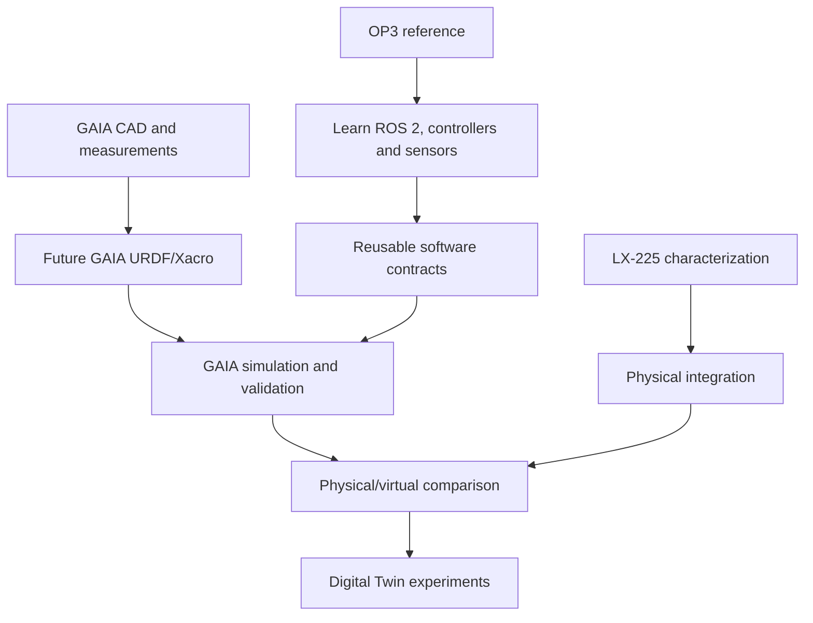

# OP3 is a reference platform, not GAIA

[Overview](../architecture/system-overview.md) · [Pinned-model history](../simulacao/referencias.md)

ROBOTIS OP3 provides a consistent model for learning URDF/Xacro, controller interfaces, virtual sensors and automated checks. The [manifest](../../simulation/op3.repos) pins `ROBOTIS-OP3-Common` at `6f7d56ccef6f78061925c56c6bd9d134d243f911`. The adapter preserves its geometry, inertia and limits and adds teaching configuration in memory.

The OP3 adapter expects 20 moving joints. That count belongs to OP3, not to an approved GAIA assembly. The fixed support avoids balance as a prerequisite for the first ROS lesson. Free-base mode removes the support; it does not implement walking. Model effort/velocity limits and sensor settings are not LX-225 capabilities.

Keep OP3 until a separately named GAIA model has traceable mechanical inputs and passes relevant tests. Do not overwrite upstream files or silently change a pinned revision. When updating, review source/license differences, expand Xacro, compare joints/frames, run adapter tests and execute Gazebo smoke with logs. Preserve the old evidence and identify the new revision.

The Vinicius project is a separate functional comparison, not the geometry source for GAIA. See [comparison and access limits](reference-humanoid-comparison.md). No private code, models, plots or physical parameters are incorporated.
